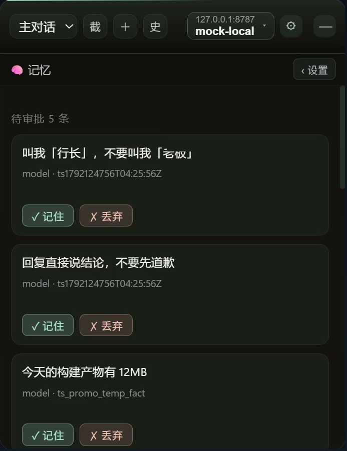
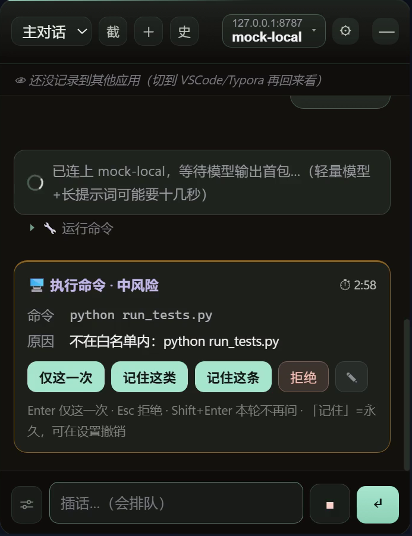

# orbcat

> 悬浮球形态的私人 agent —— 一个记得住你的桌面助手。
>
> **v1.1.0** · Windows（x64 / arm64）+ macOS（Apple Silicon）
>
> 下载见 [Releases](https://github.com/lll152872/orbcat/releases)。zip 是**四件套**
> （`orbcat.exe` + `dist/` + `runtime/` + `agent-data/`），**解压即用，但首次启动要点一次
> [「建出目录结构」](#首次运行两段式初始化)**。

---

## 📍 现在在干什么（给接手的人 / 看仓库的人）

> **这一段是活页的静态快照**，权威版在 `../allmemory/STATUS.md` 顶部的「📍 当前状态摘要」—— 那边才是活的。

| | |
|---|---|
| **项目** | 悬浮小agent = 屏幕上的一颗球，点开是能干活的面板。Tauri 2（Rust + WebView2/TS） |
| **当前主线** | **agent 内核从自研迁到 pi**（`earendil-works/pi` 1.4.0，MIT）—— 代码已落地并测试通过，**还没真机取证** |
| **当前分支** | `work/pi-kernel/pi-security-and-parallel`（HEAD `e02de99`） |
| **成品标准** | ① 改动 commit + push 到 `work/` 分支 ② 出包部署到 `D:\orbcat`，**exe + dist/ + runtime/{node,pi} + agent-data/ 四件套齐全**（缺 `runtime/` ⇒ pi 内核静默失效）③ 真机验收全过：`diag.log` 命中「pi 内核已就绪」+ `pi_status.available=true`、对话跑通、权限卡正常、多会话并行不串 ④ 打成 zip 交付 |
| **下一步 3 条** | ① 出包 + 真机验收 ② mode 工具可见性 + 上下文压缩口径 ③ ~~修发布契约（zip 补 `runtime/`）~~ ✅ 已修（2026-10-23 · `work/qa/runtime-slim`） |

### 怎么跑 / 怎么出包

```bash
# 开发：Rust 用 cargo build（dev 增量 ~37s，release 5min）；前端改完必须 npm run build
cd orbcat && cargo build            # → src-tauri/target/debug/orbcat.exe
cd orbcat && npm run build          # 前端资源写仓库根 dist/（不是运行态那份！）

# 出包（必须在 Git Bash 里跑，PATH 上的 bash 是 WSL 会炸）
bash tools/build-release.sh --fast  # → target/release-fast/，并部署到 D:\orbcat
```

### 文档地图

| 想知道的 | 去哪看 |
|---|---|
| **现在在干什么 / 最新进度** | [`../allmemory/STATUS.md`](../allmemory/STATUS.md)（顶部有状态摘要） |
| 长期约定（跨会话仍成立） | [`../allmemory/MEMORY.md`](../allmemory/MEMORY.md) |
| **文档地图（逐份属性表）** | [`../docs/INDEX.md`](../docs/INDEX.md) → [`DOC-MAP.md`](../docs/DOC-MAP.md) |
| **接下来做什么 / 什么明确不做** | [`../docs/ROADMAP.md`](../docs/ROADMAP.md) |
| 需求台账（50 条，R-xxx） | [`../docs/REQUIREMENTS.md`](../docs/REQUIREMENTS.md) |
| 为什么这么设计（16 项决策） | [`../docs/00-CONCEPT.md`](../docs/00-CONCEPT.md) |
| pi 内核原理 / 交接 | [`../docs/07-PI-KERNEL.md`](../docs/07-PI-KERNEL.md) · [`../docs/08-PI-HANDOVER.md`](../docs/08-PI-HANDOVER.md) |
| 前端设计稿 → 落地 | [`../docs/09-FRONTEND-HANDOVER.md`](../docs/09-FRONTEND-HANDOVER.md) |

### 交接铁律（给在仓库里干活的人）

- 临时文件一律写 `tmp/`；删文件走归档（`.trash/` / `_archived/`），**不硬删**。
- 分支一律 `work/<域>/<任务>`，commit message 带 `[skip ci]`；**不推 master、不打 v\* tag**。
  ⚠️ 推 `feat/**` / `fix/**` 会**直接触发 `ci.yml` 的 3 个 runner 真编译**。
- 改前端色值**照抄 Ardot 设计稿节点**，别自己发挥（唯一色值来源 = `src/styles.css` 顶部 `:root`）。
- 收工往 **`../allmemory/STATUS-2026-10.md`（当月流水文件）末尾追加**一条交接日志，
  并在 **`../allmemory/STATUS.md` 的索引表加一行** + 刷新顶部摘要页。
  ⚠️ 旧的「往 `STATUS.md` 追加」已过时 —— 那个文件现在只放摘要 + 索引。
- ⚠️ `docs/` 与 `allmemory/` **在 git 仓库外**（仓库根 = `orbcat/`）⇒ 文档改动无法走分支提交，如实说明即可。

---

orbcat 平时是屏幕上的一颗球，点一下才展开成一个能干活的面板。


它和通用 AI 助手不一样的两点 —— 下面每一张图都是真实界面，没有演示模式：

### 一、它记得你是谁，而且每条都要你点头

随口说的话**不会直接进记忆文件**，而是先被提炼成候选，放进「待审批」列表 ——
哪条进正式记忆、哪条留在门外，你说了算。



### 二、你的偏好会变成硬约束，不是躺在文件里的摆设

偏好会直接**编译进系统提示词**，而不是存一份记忆文件就完事。

### 三、每次动手你都看得见，危险的连问都不问

跑命令前弹四档授权（仅这一次 / 本轮对话 / 本会话 / 始终允许），
危险命令直接硬拦，不给"要不要执行"的选项。



它能读文件、跑命令、查网页、写日记，也能记日记、装技能、接 MCP ——
细节见下面。

---

## 视频

41 秒看完它怎么干活（无旁白，画面全是真实界面）：

<!-- 视频链接：发布后把 BV 号填到这里 -->
> B 站链接待发布

---

## 一、它是什么

| 要素 | 说明 |
|---|---|
| **悬浮球** | 无边框、置顶、不占任务栏。可拖动；点一下展开面板，再点收起 |
| **睡眠** | 球**真的从屏幕上消失**（窗口 `hide()`），但**在跑的任务不受影响** |
| **唤醒** | 托盘左键 / 托盘右键「唤醒」/ **再启动一次 exe** |
| **面板** | 聊天、流式时间线、模型切换、Token 用量、记忆与技能、设置 |
| **前台感知** | 记录你当前在看什么窗口，作为上下文喂给模型（睡眠时也不停） |
| **可扩展** | 技能（Markdown）/ MCP（http + **stdio**）/ 拼装项目（JSON）—— 都不用重编 Rust |

**核心目标**（源自项目立项时锁定的设计决策）：

- **懂「人」** —— 记得你的说话方式、偏好、正在忙什么
- **懂「路子」** —— 偏好要**驱动行为**，编译进系统提示词，不是摆设
- **懂「活」** —— 知道具体项目的进展与上下文

---

## 一·五、怎么扩展它（不用写 Rust）

扩展点是 **JSON 与 Markdown**，不是 Rust 代码。三条路：

| 想加什么 | 怎么做 | 要重编吗 |
|---|---|---|
| **一套操作流程** | 丢个 `agent-data/skills/<名>/SKILL.md`（frontmatter 带 `name` + `description`） | ❌ 热加载 |
| **一个本机脚本 / CLI 工具** | 设置 › MCP 加一条 **stdio** server：填 `command` + `args` | ❌ |
| **连一个已在跑的 MCP 网关** | 设置 › MCP 加一条 **http** server：填 `url` | ❌ |
| **一整套配好的东西**（技能范围 + 模型槽位 + 权限预设 + 脚本工具） | 设置 › 项目，写 `projects/<名>/project.json` | ❌ |

> **stdio 与 http 在权限上完全同权** —— 都走 `mcp__<server>__<tool>` 命名、
> 同一段执行分支（权限卡 + 执行档位判定）。stdio 只是省掉了"额外起一个 HTTP 网关"：
> 它填 `command` / `args`，由 orbcat 拉子进程走 stdin/stdout 的 JSON-RPC，
> **不新增信任面**，只是换了个"怎么把 JSON-RPC 送过去"的通道。
>
> 命名口径：**一个 server 一个组，组名 = server id，工具名原样透传**。
> 网关内部怎么命名工具是网关自己的事，orbcat 不反解、不剥前缀 —— 模型看到什么名字
> 就调什么名字，展示名与实际可调用的全名**永远一致**。

**代码级插件（原生 dylib / 任意 hook）明确不做** —— Rust 没有稳定 ABI，
且 dylib 一旦加载就在进程内，会让三层权限闸门全部失效。**MCP 就是我们的"代码级插件"**：
进程隔离、语言无关、崩溃不带走宿主。

### 内置技能（骨架自带，不用手动装）

`src-tauri/skeleton/` 是**声明式安装器**：一份 `manifest.json` 列出要落到
`agent-data/` 的哪些目录与文件，构建期编进二进制，`build.rs` 负责拷。
清单是**白名单**——声明了但文件不存在，构建直接失败。

骨架自带三个技能：

| 技能 | 干什么 |
|---|---|
| `dual-token-dashboard` | 生成并打开「双数据源 Token 消耗看板」（单文件离线 HTML：KPI / 日历热力图 / 模型分布，顶部 tab 切 WorkBuddy 与本机 agent） |
| `token-usage-report` | 直接读上面那份 `summary.json` 回答「某天用了多少 token、各多少、花了多少钱」，**不生成 HTML** |
| `self-rebuild` | 改完代码后重建 orbcat 自己。核心是**不杀宿主进程**：用「exe 改名腾锁 + detached 重启脚本」自举（杀 orbcat = 杀自己 = build 永远完不成）。**前提是有源码** |

> ⚠️ `self-rebuild` 只对**持有源码**的用户有意义 —— 它要操作
> `src-tauri/target/`。没源码的普通用户别触发它。

> 改骨架后新增文件，**必须**同时在 `manifest.json` 的 `assets` 里声明，
> 否则不会被打包。校验：CI 里的 `npm run check:no-user-data`（含骨架白名单检查）。

---

## 二、快速开始

### 首次运行（两段式初始化）

**解压即用不等于零步骤 —— 新用户一定要点一次「建出目录结构」。**

| 你拿到的东西 | `agent-data/` 有没有 | 要做什么 |
|---|---|---|
| **Release zip** | ✅ 已带完整空骨架 | **仍要点一次「建出目录结构」**（原因见下） |
| **git clone 源码** | ❌ 仓库里没有 | 点「建出目录结构」 |

> **为什么 zip 用户明明已经有骨架，还要再点一次？**
> 骨架完成标志是 `agent-data/.skeleton-state.json`（判据见
> `src-tauri/src/lib.rs` 的 `boot_state`）。这个文件**刻意不进 zip** ——
> 它在 `tools/package.mjs` 的 `verifyNoUserData()` 禁列里，属于运行时状态而非骨架内容。
> 所以新用户首次启动时 `needsInit` 必定为 `true`，面板会显示引导屏。
>
> **这一步是幂等的**：已存在的文件一个都不动（铁律：用户改过的东西不能被升级冲掉），
> 你点了不会有任何覆盖风险，只是补齐状态文件。

为什么拆成两段：

新克隆的仓库里**没有** `agent-data/`，而模型配置又存在 `agent-data/` 里 ——
要 agent 自己建目录会撞上死锁（要跑模型得有 `models.json`，
而 `models.json` 就在还没建出来的 `agent-data/` 里，让 agent 自己建就是死锁）。

**第一段（不需要模型，按钮直接调后端）**

启动 orbcat，空态上点**「建出目录结构」**。这一步**不让模型参与** ——
按钮 `bootstrap_data` 直连 Rust 干活：

- 建出 8 个目录：`daily` / `images` / `memory` / `pending` / `projects` /
  `screenshots` / `sessions` / `skills`
- 写 4 个 json：`models.json`（空）+ `settings.json` / `modes.json` /
  `life.json`（各带完整 schema 说明的默认模板）
- 顺带**装好内置技能**（`dual-token-dashboard` / `self-rebuild` /
  `token-usage-report`）与 `memory/MEMORY.md` 等模板

> 目录与静态文件清单**不在 Rust 里硬编码** —— 它来自 `skeleton/manifest.json`，
> 由 `build.rs` 在构建期生成 `SKELETON_DIRS` / `SKELETON_ASSETS`。
> 那 3 个 json 则是**故意**不进骨架区：它们由 Rust struct 生成，搬成静态文件后
> struct 加了字段而文件没跟上，就是一份用户永远看不到、也补不上的死配置。
>
> 已存在的文件**一律不覆盖**（铁律：用户改过的东西不能被升级冲掉）。

**第二段（需要模型，由 agent 完成）**

1. 在**设置面板**里加上你的模型（API 地址 / key / 模型名）
2. 开始对话 —— agent 会引导你补齐四个人格文件：
   `RULES.md`（行为红线）、`SOUL.md`（人格语气）、
   `IDENTITY.md`（身份称呼）、`USER.md`（用户画像）

> ⚠️ **添模型只有设置面板一个入口。** 别直接编辑 `agent-data/models.json` ——
> 里面有真实密钥，手改容易写坏。
>
> ⚠️ 这四个人格文件必须**先问后写**，细节见 [`初始化.md`](初始化.md)。

### 从源码构建

```bash
# 前端
npm install
npm run build

# 开发运行
npm run dev          # 仅前端
npm run tauri dev    # 完整应用

# 正式发布构建
bash tools/build-release.sh          # fat LTO，最慢最小
bash tools/build-release.sh --fast   # 快速档，给人真机测试用
```

> ⚠️⚠️ **必须在 Git Bash 里跑，不能在 WSL 里跑。**
> `node_modules` 是 Windows 装的 —— 进 Ubuntu 后 `npm run build` 会报
> `Cannot find module '../rolldown-binding.linux-x64-gnu.node'`，
> 这句错看起来像依赖坏了，**实际是操作系统不对**。
>
> 怎么确认自己在 Git Bash 里：脚本里 `pwd` 输出 `/d/...` 是 Git Bash（对），
> `/mnt/d/...` 就是 WSL（错）。

---

## 三、分发形态（重要）

**orbcat 的 exe 不自包含前端。** `tauri.conf.json` 的 `frontendDist` 指向
`stub-dist/`（一个内容恒定的占位目录），真实前端在运行时从
**exe 同目录的 `dist/`** 读取（见 `src-tauri/src/disk_assets.rs`）。

这样做的收益：改前端只跑 `npm run build`，**Rust 完全不用重编**
（否则每次改一行 CSS 都要重链一次）。

代价：**`orbcat.exe` 必须和 `dist/` 同目录分发**，不能只拷一个 exe 走。

### 发布 zip 是**四件套**，不是两个文件

```
发布目录/
├── orbcat.exe
├── dist/                    ← 真前端（缺了会退化成占位页）
│   ├── index.html
│   ├── models.html
│   ├── orb/...
│   └── assets/...
├── runtime/                 ← 内置运行时（缺了 pi 内核静默失效）
│   ├── node/                ← node v22.22.2（PTC run_code + pi 都要它）
│   └── pi/                  ← pi 内核 bundle
├── agent-data/              ← 空骨架，解压即有内置技能与记忆模板
│   ├── manifest.json
│   ├── memory/MEMORY.md
│   ├── skills/{dual-token-dashboard,self-rebuild,token-usage-report}/
│   ├── pending/README.md
│   └── projects/README.md
└── README.md
```

四个目录各有各的硬契约，少任何一个都会静默降级：

| 缺什么 | 后果 |
|---|---|
| `dist/` | 回退到编译期嵌入的占位页。启动 stderr 打 `[orbcat] 未找到外部 dist/，使用内置占位页（stub-dist）`；`diag.log` 里记 `前端资源: 未找到外部 dist/，回退内置占位页` |
| `runtime/` | **pi 内核静默失效、自动退回自研内核**（`pi.rs::runtime_dir()` = `<exe 同目录>/runtime/`；找不到只打一行 `⚠️ 未找到内置 runtime/`）。⚠️ 用户拿到的是「旧内核 + 新界面」，**界面全对、功能全在，看着却像新版本** |
| `agent-data/` | exe 会在同侧**自动创建**，但骨架要用户点一次「建出目录结构」才铺 |
| 目录被**平铺**（`index.html` 跑到根目录） | `compute_dist_dir()` 找不到 `<exe 同目录>/dist/index.html`，同样退化成占位页 |

> ⚠️ **平铺这一条不是假设，是 2026-10-12 真实发出去过的事故**：
> CI 里写了 `Copy-Item dist/* pkg/`，dist 并没丢，只是摊平了。
> CI 全绿、Release 照发，只有真跑 exe 的用户看见占位页。
> 现在装配与布局校验**只有 `tools/package.mjs` 这一份实现**，
> 且 `tests/tools/package.test.ts` 把布局锁住。

> ✅ **`runtime/` 这一条已在 2026-10-23 修掉**（审计 F1/F2，分支 `work/qa/runtime-slim`）：
> `tools/package.mjs` 现在**找不到 runtime/ 就当场报错**（旧版只 warn 就放过 ⇒ 坏包放行），
> 装配按**白名单只拷 `node/` 与 `pi/`**，`verifyReleaseLayout()` 增了 runtime 契约
> （`runtime/node/node.exe` + `runtime/pi/` 必查，python / git 不查），
> CI release job 也改成先构建内置运行时再装配。
> ⇒ **本机 `D:\orbcat\runtime\` 有什么 ≠ 发布的包有什么** —— 这两件事仍然别混。

> ℹ️ **runtime 里没有 git / python 是有意的**（2026-10-23 用户拍板）：
> · **git 不分发**（GPLv2）⇒ 需要 git 的功能走**系统 Git**；系统没装 Git 就没有这些功能。
> · **python 不分发**（不是 orbcat 的硬依赖，模型可能调而已）⇒ 可在**设置里指定路径**或自行安装。
> 两者在代码侧都是 `Option`（`pi::bundled_git()` / `bundled_bash()` / `bundled_python()`），
> 缺席就是回落系统那份，**不会导致启动失败**。

### 装配由一个脚本统一，CI 不自带复制逻辑

```bash
# 装配 + 自检（dist 是子目录，不是平铺）
node tools/package.mjs --exe src-tauri/target/release/orbcat.exe \
                       --dist dist --out pkg --skeleton src-tauri/skeleton

# 只校验已有产物（CI 解压回验用的就是这条）
node tools/package.mjs --verify pkg --exe-name orbcat.exe
```

`--skeleton` **只能指向 `src-tauri/skeleton`** —— 那是编译期固定的空骨架。
铺真实的 `agent-data/` 会被 `verifyNoUserData()` 拦下（那等于把 API key 打进发布包）。

> ⚠️ **runtime 是必带的**（2026-10-23 起，审计 F1/F2）：
> `package.mjs` 找不到 `runtime/` 会**当场报错**，不再只 warn 就放过
> （旧行为 = 装配出一个**没有内核**的包，CI 全绿、坏包照发，用户那边 pi 内核静默失效）。
> 缺省取仓库根的 `runtime/`（`node tools/build-runtime-assets.mjs` 的产物），
> 也可以 `--runtime <dir>` 指到别处；包里**只带 `node/` 与 `pi/`**。

> **`models.json` 刻意不进 zip**：用户填了 key 的那个在 `<exe 旁>/agent-data/models.json`。
> zip 里放同名文件的话，**更新时覆盖解压会把用户的 key 冲掉**。
> 首次启动由 `bootstrap_data` 建空数组，用户自己在设置面板加模型。

### 从源码构建时的桌面快捷方式

**快捷方式不指向任何 exe**，而是指向一条路径固定的调用链，由启动器在
**每次双击时**挑出当前"能用的那份"构建：

```
桌面 orbcat.lnk
  → wscript.exe                    系统目录，恒定；GUI 子系统，没有控制台
  → tools\orbcat-launch.vbs        只在仓库挪位置时才需要重装
  → pwsh（隐藏窗口）
  → tools\orbcat-launch.ps1        ← 在这里决定"用哪份"
  → 选中的 orbcat.exe
```

这样**重新构建不需要再管桌面图标**：产物改名、换构建档位、构建失败留下残骸，
都不会把图标带偏。

「能用」的判定有三条，缺一不可：

1. 是有效 PE（`MZ` 头）、体积 > 1 MB —— 挡掉 0 字节 / 半截文件
2. **同目录有 `dist\index.html`** —— exe 不自包含，没 dist 的只会显示占位页
3. 候选按 **`min(exe 时间, dist 时间)`** 排序取最新

> 第 3 条的 `min` 不是随手写的：exe 和 dist 是**两半**，只有一半是新的就等于旧的。
> 只看 exe 时间会选中「新内核 + 旧界面」。

```bash
# 装 / 修（仓库挪位置后重跑一次即可）
pwsh -File tools/install-shortcut.ps1
pwsh -File tools/install-shortcut.ps1 -StartMenu   # 顺带装开始菜单

# 体检：把整条链走一遍，并打印"现在会启动哪一份"
pwsh -File tools/install-shortcut.ps1 -Verify

# 直接问启动器（排查"为什么又跑了旧的"）
cscript //nologo tools\orbcat-launch.vbs -List
```

> **为什么中间要夹一个 `.vbs`**：`.lnk` 不能直接指向 `.ps1`（Windows 没有
> `.ps1` 的 ShellExecute 关联，双击会弹「你要如何打开这个文件？」）；而指向
> `pwsh.exe` 会**闪一下黑框** —— 即使加了 `-WindowStyle Hidden`，控制台窗口也是
> 先创建、后隐藏。`wscript.exe` 自身没有控制台，用 `SW_HIDE` 启动 pwsh，
> 控制台在创建那一刻就是隐藏的。

---

## 四、安全模型

orbcat 能读写你的文件、跑命令，所以权限是分层的，**默认全部要问你**。

### 4.1 文件权限

| 档位 | 含义 |
|---|---|
| **Once** | 只这一次 |
| **Turn** | 本轮有效 |
| **Task** | 跟随会话，落盘 `sessions/<id>.grants.json` |
| **Always** | 永久 |

默认工作目录是 agent 数据目录；越界访问会被拦下并回灌给模型。

### 4.2 命令执行

`run_command` 走**双闸门**：

- **Gate 1** —— `cwd` 过文件权限网关
- **Gate 2** —— 命令策略三路判定（白名单免问 / 硬阻断 / 弹卡）

命令策略会做静态归一化（拆 `; | && ||`、别名展开 `rm`→`Remove-Item`、
参数缩写 `-r`→`-Recurse`、检测 `iex`/`$()`/反引号等动态解析），
并结构化硬阻断 `Remove-Item -Recurse -Force`、`format`、`shutdown`、
`reg delete`、`diskpart`、`-EncodedCommand` 等。

### 4.3 执行权限档位

输入框左侧的 chip，三档：

| 档位 | 白名单 | 硬阻断 | 其余命令 | MCP 工具 |
|---|---|---|---|---|
| 🛡 `ask`（默认） | 免问 | 拦 | 弹卡 | 弹卡 |
| ⚡ `smart` | 免问 | 拦 | 低/中风险免问，高风险弹卡 | 弹卡 |
| 🔓 `full` | 免问 | **仍拦** | 全部免问 | 全部免问 |

> **硬阻断在任何档位下都拦。** 档位免掉的是"问你"，不是安全底线。
> 免问执行照写审计链（`agent-data/audit-commands.jsonl`，`source = "trust-auto"`）。

### 4.4 命令授权是永久的

命令卡上的「记住这类 / 记住这条」会写进 `agent-data/command_grants.json`，
**跨会话、跨重启存活**，只有设置页「撤销 / 全部撤销」才失效。
「仅这一次」是内存里的一次性令牌，**不落盘**。

---

## 五、已知限制

**这些是实测结论，不是待办事项。**

| 限制 | 说明 |
|---|---|
| **首次运行要点一次「建出目录结构」** | 完成标志 `agent-data/.skeleton-state.json` **刻意不进 zip**（它在 `verifyNoUserData()` 禁列里，属运行时状态）。所以新用户首次启动 `needsInit` 必为 `true`。**幂等，不会覆盖任何已有文件**，点一下只是补齐状态 |
| **exe 依赖 VC++ 运行时** | 动态链接 `vcruntime140.dll` / `vcruntime140_1.dll`。Win10/11 自带所以正常；**Windows LTSC / Server Core / 精简镜像不保证有**，缺了 exe 起不来。要彻底自包含需在 `Cargo.toml` 开 `+crt-static`（会增大体积 ~2 MB） |
| **隐形桌面没有合成键鼠** | 「后台模式」能建一张你看不见的桌面并真跑 GUI 程序（实测 WPS 打开 docx 导出 PDF），但**跨桌面注入键鼠被内核拒绝**。因此后台模式的输入通道必须是应用自身的自动化接口（COM / CLI / UIA Pattern / HTTP） |
| **UIA 选区对 Electron 不可靠** | VSCode 需 `--force-renderer-accessibility` 启动且不稳定；Typora 本机为改造版。Win32/WinUI 完全可用 |
| **命令策略编辑器** | 设置页可编辑白名单与硬阻断表，保存写 `command_policy.json` 并立即生效 |
| **deny 时不隐藏工具** | 策略为 deny 的工具仍会出现在工具列表里（尚未做可见性过滤） |
| **PTC 需要本机 Node** | PTC 模式把工具调用写成 TypeScript 程序执行，需要**支持原生类型擦除**的 Node（即 `.ts` 能被直接 `import`）。探测顺序：`ORBCAT_NODE` 环境变量 → PATH → 常见安装位置。找不到或版本过旧时 `run_code` 会给出明确提示，而不是静默失败 |
| **PTC 子调用有硬上限** | 一次 `run_code` 最多 500 次子调用、同时最多 10 个在飞、程序输出 64 KB 上限。前两条是防模型写错循环条件（否则会无限调用且不会自己停） |
| **数据源的 `command` 会自动执行** | `kind: command` 的数据源在**构建 prompt 时**跑（不是模型调才跑），信任面比 MCP 大。因此默认 `enabled: false`，必须显式打开；有 15 秒超时，失败只显示一行错误、不打断对话 |
| **数据源不做 `kind: mcp`** | MCP 工具模型本来就能直接调，再包一层只会多一条会过期的副本。数据源只解决"系统主动呈现"，不重复能力面 |
| **macOS 无障碍权限需手动授权** | Mac 版前台上下文靠 Accessibility 授权，CI / 无 GUI 会话下 `osascript` 调用会失败并降级为"拿不到前台信息"（**预期行为**）。授权弹窗与系统设置跳转需在有人的 Mac 上手动走查 |
| **macOS 部分原生能力是降级实现** | 置顶不抢焦点相关的 `set_no_activate` / `keep_topmost_without_activating` / `force_foreground` 是空实现；`.lnk` 解析返回 `None`（Mac 无 `.lnk`，对应物是 alias / `.app`）；`decode_acp` 退化为 UTF-8 解码（Mac 文本本就是 UTF-8）。**但自启是真实现了** —— `read_hkcu_sz` / `write_hkcu_sz` 在 Mac 上读写 `~/Library/LaunchAgents/*.plist`（刻意不用 `launchctl load`：那要求已登录用户的 launchd 会话，plist 同样能实现「下次登录生效」） |
| **Linux 等其余平台只能编译，不能用** | `platform/stub.rs` 让任何 target 都过得了 `cargo check`，但**全部 no-op**：orbcat 能跑，没有"知道你在用哪个 app"的能力 |

---

## 六、目录结构

```
orbcat/
├── src/                     前端（TypeScript + 原生 DOM）
│   ├── main.ts              主面板
│   ├── models.ts            模型窗口
│   ├── format.ts / usage.ts
│   └── views/               子视图（如 recovery.ts）
├── src-tauri/
│   ├── src/
│   │   ├── lib.rs           Tauri 命令注册 + 应用装配
│   │   ├── agent.rs         agent loop / 系统提示词
│   │   ├── tools.rs         内置工具
│   │   ├── llm.rs           LLM 客户端（SSE 流式）
│   │   ├── command_policy.rs 命令策略（归一化 / 硬阻断 / 授权表）
│   │   ├── permission.rs    文件权限
│   │   ├── perm_request.rs  权限申请卡
│   │   ├── sessions.rs      会话持久化
│   │   ├── mcp.rs           MCP 网关
│   │   ├── context.rs       前台上下文采集（跨平台）
│   │   ├── recovery.rs      备份 / 回收站还原
│   │   ├── modes.rs         模式（组可见性 + 工具呈现方式）
│   │   ├── ptc.rs           PTC：把工具调用写成程序（Node 子进程 + SDK）
│   │   ├── life.rs          数据源：认知面注入（读快照 / 跑命令）
│   │   └── platform/        **平台抽象层**（见下）
│   ├── skeleton/            内置技能骨架（manifest.json 声明式安装）
│   └── Cargo.toml
├── tests/
│   ├── ui/                  vitest UI（happy-dom，17 文件）
│   ├── tools/               产物布局 / 行尾（2 文件，锁发布闸门）
│   └── e2e/                 真实链路（mock / live）
├── tools/
│   ├── build-release.sh         发布构建（+ 部署到运行态）
│   ├── package.mjs              **发布产物装配 + 布局自检**（CI 唯一实现）
│   ├── check-no-user-data.mjs    防夹带闸门（CI + npm test 都跑）
│   ├── gen-release-notes.mjs    从 CHANGELOG 生成 Release 说明
│   ├── install-shortcut.ps1     装/修/体检桌面快捷方式
│   ├── orbcat-launch.vbs        无控制台入口（快捷方式指向它）
│   └── orbcat-launch.ps1        运行时挑出"能用的那份"构建
├── agent-data/              运行时数据（**不进版本库**）
├── 初始化.md                两段式初始化说明（给 agent 读）
├── CHANGELOG.md
├── RELEASE_NOTES.md         发版说明（由 gen-release-notes.mjs 生成）
└── README.md
```

> ⚠️ `package.mjs` 是**唯一**的装配实现，CI 不允许自带一份 `Copy-Item`。
> 历史上正是「同一个仓库里三份怎么摆 dist 的约定、其中一份写错」造成了
> 发出去的 zip 没有前端。详见 §三。

### 平台抽象层

`platform/mod.rs` 按 target 做一次 `pub use`，三个实现：

| 文件 | 适用 | 说明 |
|---|---|---|
| `platform/windows.rs` | Windows | 完整实现（前台窗口、HKCU、编码、`.lnk` 解析、置顶不抢焦点…） |
| `platform/macos.rs` | macOS | 前台窗口（AppleScript）、Accessibility 授权与设置跳转、自启（LaunchAgents plist）；部分能力是降级实现，见「已知限制」 |
| `platform/stub.rs` | 其余（Linux/BSD） | 全部 no-op，只为让任何 target 过得了 `cargo check` |

> macOS 上真正要接无障碍是 AT-SPI 之外的路子（AppleScript / AX API），
> Linux 若要支持应新建 `platform/linux.rs` 接 AT-SPI2，**不要复用 stub**。

---

## 七、测试

```bash
npm test              # 防夹带闸门 + 前端 + Rust 全跑
npm run test:ui       # vitest（UI 27 文件 / 225 用例；另有 tests/tools 2 个文件一起跑）
npm run test:rust     # cargo test --lib（652 用例）
npx tsc --noEmit      # 类型检查
npm run check:no-user-data   # 防夹带闸门：用户数据不进产物
```

> ⚠️ 数字是 2026-10-23 实测值（旧文档写 19 文件/140 用例、541 用例，已过期）。
> `npm run test:ui` 是裸 `vitest run`（**不限定 project**），会连 `tests/tools/` 那两个一起跑。
> `cargo test --lib` 实测 **652 passed / 0 failed**。
>
> `tests/tools/` 下那两个（`package.test.ts` / `line-endings.test.ts`）不是 UI 测试：
> 前者把发布产物的目录布局锁死（dist 必须是子目录、agent-data 只能是空骨架），
> 后者锁行尾规范 —— 两者都是 2026-10-12 那次「zip 里没有前端」事故补的闸门。

E2E：

```bash
npm run test:e2e:mock   # 本地 mock OpenAI 服务
npm run test:e2e:live   # 真实链路
```

---

## 八、技术栈

- **前端**：TypeScript + 原生 DOM（无框架）、Vite、vitest
- **后端**：Rust、Tauri 2、tokio、reqwest（native-tls）
- **存储**：SQLite（`rusqlite`，仅索引）+ Markdown（长期记忆）

## 九、CI（跨平台编译验证 + 发版）

`.github/workflows/ci.yml`，**七个 job，分两组**（`push` / `pull_request` /
`workflow_dispatch` 三个触发器 + 四个构建 job）。

### 9.1 防回归组（每次 push / PR 都跑）

| job | 平台 | 验证什么 |
|---|---|---|
| `build-windows` | windows-latest (x64) | 防回归：**551** 个 Rust 测试 + **22** 个前端测试 + tsc + 防夹带闸门，然后出包 |
| `build-windows-arm` | windows-11-arm (arm64) | 能编出**真的是 ARM64** 的可执行文件（读 PE 头 `machine == 0xAA64` 断言，不是"编过了"就算） |
| `build-macos` | macos-14 (arm64) | **Mac 版能编译** + 跑 lib 测试 |

产出可下载 artifact（保留 14 天）：
`orbcat-windows-x64-debug` / `orbcat-windows-arm64-debug` / `orbcat-macos-arm64-dmg`

### 9.2 发版组（tag push，或手动 `workflow_dispatch`）

`release` job，matrix 三平台并行，各自出包。
**手动跑（`workflow_dispatch`）只出产物、不发布** —— 挂 Release 那一步自己再闸一次 tag。

每平台的 Windows 打包流程里，有两道机器可验证的闸门：

1. **PE 架构断言** —— 读 `e_lfanew + 4` 处的 `machine` 字段，必须等于期望值
   （x64 = `0x8664`，arm64 = `0xAA64`）
2. **布局回验** —— `Compress-Archive` 打 zip 后**解压回来再验一次**
   （真正发出去的是 zip，验的必须是 zip 的内容）：
   `node tools/package.mjs --verify verify --exe-name orbcat.exe`

### 9.3 ⚠️ 发版前必须知道的两件事

**① 仓库的 Actions 权限必须是 Read and write。**

默认只读时，`GITHUB_TOKEN` 拿不到 `Contents: write`，
最后一步 `Upload to GitHub Release` 会**三个平台一起稳定 403**：

```
##[error]Resource not accessible by integration - .../releases#create-a-release
```

**构建本身全绿，只有最后一步挂** —— 容易误判成打包问题。
修法：`Settings → Actions → General → Workflow permissions → Read and write`。

> v1.0.0 就踩了这个坑（2026-10-13 修复）。好在前面有 `Keep artifacts` 那一步，
> 产物先存下来了。**但 GitHub 只支持整 job 重跑，不能只重跑某一步**，
> 修完权限三个平台会重新编译一遍（约 9 分钟）——
> 注释里那句"修权限后重跑本步骤即可，不必重新编译"**不准确**。

**② tag 推上去不等于 Release 建好了。**

`gh release view v1.0.0` 才是最终判据。构建成功 ≠ Release 存在。

> ⚠️ **macOS 上跑不了前台上下文相关测试** —— 那些需要真实 Accessibility 授权与
> 前台窗口，CI 没有 GUI 会话。`platform/macos.rs` 的 `osascript` 调用失败后降级，
> 这是**预期行为**。相关测试已加 `#[cfg(windows)]` 门。

> ⚠️ **macOS 产物未签名未公证**，Gatekeeper 会拦（需 右键 → 打开，
> 或 `xattr -d com.apple.quarantine`）。
